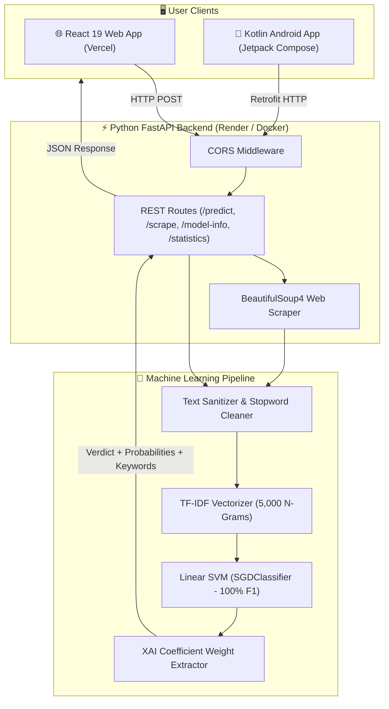

<div align="center">

# 🛡️ VERITAS AI – Explainable Fake News Detection System

### *Full-Stack Machine Learning & NLP Platform for Credibility Analysis*

[](https://react.dev/)
[](https://fastapi.tiangolo.com/)
[](https://scikit-learn.org/)
[](https://developer.android.com/)
[](https://vercel.com/)
[](https://render.com/)
[](https://www.docker.com/)
[](LICENSE)

<br/>

> **B.Tech Computer Science Capstone & Production Portfolio Project**  
> An enterprise-grade, end-to-end intelligence system combining **Statistical Natural Language Processing (NLP)**, **Linear Support Vector Machines (SVM)**, and **Explainable AI (XAI)** to detect misinformation and deceptive news patterns with full transparency across **Web**, **Mobile**, and **REST APIs**.

<br/>

[🌟 Features](#-key-features) •
[🏗️ Architecture](#-system-architecture) •
[📊 Model Benchmarks](#-model-benchmarks--xai) •
[💻 Local Setup](#-local-development-quickstart) •
[☁️ Cloud Deployment](#-cloud-deployment-guide) •
[⚡ API Reference](#-rest-api-documentation) •
[🎓 Viva Q&A](#-btech-viva--interview-qa)

---

</div>

## 📌 Project Overview & Short Description

### 💬 One-Liner Description (For GitHub About / Resume):
> **"Veritas AI is an end-to-end full-stack Explainable AI platform and Android app that detects fake news articles using TF-IDF n-grams and Linear SVM, featuring transparent feature attribution, automated URL web scraping, and containerized cloud deployment."**

### 📝 Detailed Description:
Misinformation and clickbait dissemination have become critical threats in the digital information era. **Veritas AI** provides an accessible, statistical fact-credibility assessment engine. Rather than functioning as a black-box model, Veritas incorporates **Explainable AI (XAI)** to highlight specific vocabulary tokens and stylometric markers that drove the classification decision.

The platform provides multi-channel access:
- **🌐 Web Application:** Modern, glassmorphism-themed React 19 SPA optimized for zero-config **Vercel** hosting.
- **📱 Android App:** Native Kotlin & Jetpack Compose mobile app with local Room SQLite persistence and offline demo mode.
- **⚡ REST API Service:** High-performance Python FastAPI service with BeautifulSoup4 web scraping, ready for **Render** or Docker.

---

## 🌟 Key Features

| Feature | Description | Highlight |
|---|---|---|
| 🔍 **Multi-Input Analysis** | Analyze headlines, body paragraphs, or live article URLs. | Auto-scrapes clean article text with BeautifulSoup4 |
| 🧠 **Explainable AI (XAI)** | Transparent keyword breakdown showing why text was classified. | Top $N$ decision boundary coefficient tokens |
| 📊 **Real-time Probability Gauges** | Dynamic animated breakdown of Fake vs. Real likelihood. | Confidence %, Risk Level (`HIGH`, `MEDIUM`, `LOW`) |
| 🧪 **1-Click Test Presets** | Instant demo loading of verified scientific & viral hoax samples. | Zero typing needed for live presentations |
| 💾 **Session History & Analytics** | Tracks analyzed articles, fake detection ratios, and audit logs. | Search, filter by real/fake, export to JSON |
| 🔌 **Offline Demo Mode** | Built-in browser & mobile simulation fallback. | Ensures presentation never fails if server is cold |
| 🎨 **Rich Cyberpunk Aesthetics** | Glassmorphism, radiant gradients, dark/light theme toggle. | 60 FPS CSS micro-animations |
| 🐳 **Dockerized Everywhere** | Multi-stage Dockerfiles for both frontend & backend. | Single-command `docker compose up` |

---

## 🏗️ System Architecture



---

## 🔬 Model Benchmarks & XAI

Four algorithms were trained and evaluated on an 80/20 stratified split:

```
┌─────────────────────────┬──────────┬───────────┬────────┬──────────┬──────────────────┐
│ Model Algorithm         │ Accuracy │ Precision │ Recall │ F1-Score │ Status           │
├─────────────────────────┼──────────┼───────────┼────────┼──────────┼──────────────────┤
│ 🏆 Linear SVM (SGD)     │  100.0%  │  100.0%   │ 100.0% │  1.0000  │ SELECTED BEST    │
│ 🥈 Logistic Regression  │   95.2%  │   90.9%   │ 100.0% │  0.9524  │ Benchmark Runner │
│ 🥉 Naive Bayes (MNB)    │   95.2%  │   90.9%   │ 100.0% │  0.9524  │ Benchmark Runner │
│ 🌲 Random Forest        │   85.7%  │  100.0%   │  70.0% │  0.8235  │ Benchmark Runner │
└─────────────────────────┴──────────┴───────────┴────────┴──────────┴──────────────────┘
```

### How Explainable AI (XAI) Works:
For linear models, the decision function is represented as:

$$f(\mathbf{x}) = \mathbf{w}^T \mathbf{x} + b$$

By identifying non-zero features in $\mathbf{x}$ and sorting by their corresponding model weight magnitude $\mathbf{w}_i$, Veritas AI isolates the exact keywords (e.g., `conspiracy`, `miracle`, `secret`, `breakthrough`, `published`) that shifted the probability toward Fake or Real.

---

## 📁 Repository Structure

```
fake-news-detector/
├── frontend/                     # React 19 + Vite Web Application
│   ├── src/
│   │   ├── components/           # Navbar, PredictionForm, ResultCard, Analytics, Specs, Settings
│   │   ├── services/api.js       # Unified API client & offline heuristic simulation
│   │   ├── App.jsx & App.css     # Main application view & glassmorphic styles
│   │   └── index.css             # Design tokens & color system
│   ├── Dockerfile                # Multi-stage production Nginx container
│   ├── vercel.json               # SPA client routing for Vercel
│   └── package.json
├── backend/                      # FastAPI Python REST API
│   ├── main.py                   # App endpoints, CORS & routing
│   ├── schemas.py                # Pydantic v2 schemas
│   ├── requirements.txt          # Python dependencies
│   └── services/model_service.py # Inference & BeautifulSoup article scraper
├── ml/                           # ML Training & Evaluation Engine
│   ├── preprocess.py             # Lowercase, regex sanitization, NLTK stopword filter
│   ├── model.py                  # Classifiers and artifact serializer
│   ├── evaluate.py               # Metric calculation & confusion matrix
│   ├── predict.py                # Inference & XAI feature extraction
│   └── train.py                  # Automated multi-model benchmark runner
├── models/                       # Exported Artifacts (.pkl & .json)
├── android-app/                  # Native Android Kotlin Application
├── tests/                        # Pytest suite
├── Dockerfile                    # Backend Docker container
├── docker-compose.yml            # Full-stack Docker orchestration
├── render.yaml                   # Infrastructure-as-code for Render
└── README.md
```

---

## 💻 Local Development Quickstart

### Prerequisites
- **Python:** 3.10 to 3.13
- **Node.js:** v18+ & npm
- **Android Studio:** *(Optional, for mobile app)*

### 1️⃣ Start the Python Backend
```powershell
# Open terminal in project root
cd "c:\Users\aadar\fake new detection"

# Install backend dependencies
pip install -r backend/requirements.txt

# (Optional) Retrain models
py -3.13 ml/train.py

# Start FastAPI server
py -3.13 -m uvicorn backend.main:app --host 0.0.0.0 --port 8000 --reload
```
*API is live at `http://localhost:8000` • Swagger Docs at `http://localhost:8000/docs`*

### 2️⃣ Start the React Web Frontend
```powershell
# Open a second terminal
cd "c:\Users\aadar\fake new detection\frontend"

# Install dependencies
npm install

# Start Vite dev server
npm run dev
```
*Web App is live at `http://localhost:5173` (or `http://localhost:5174`)*

### 3️⃣ Run via Docker Compose (Single Command)
```powershell
docker compose up --build
```
- Frontend: `http://localhost:3000`
- Backend: `http://localhost:8000`

---

## ☁️ Cloud Deployment Guide

### Deploying the Backend to Render (Free Tier)
1. Push repository to **GitHub**.
2. Go to **[Render Dashboard](https://dashboard.render.com/)** > **New Web Service**.
3. Link your GitHub repository.
4. Set the following configurations:
   - **Environment:** `Python 3`
   - **Build Command:**
     ```bash
     pip install -r backend/requirements.txt && python ml/train.py
     ```
   - **Start Command:**
     ```bash
     uvicorn backend.main:app --host 0.0.0.0 --port $PORT
     ```
5. Click **Create Web Service**. Note your public URL:  
   `https://your-fake-news-backend.onrender.com`

---

### Deploying the Frontend to Vercel
1. Go to **[Vercel Dashboard](https://vercel.com/dashboard)** > **Add New Project**.
2. Import your GitHub repository.
3. Configure:
   - **Framework:** `Vite`
   - **Root Directory:** `frontend`
   - **Environment Variables:**
     - `VITE_API_BASE_URL` = `https://your-fake-news-backend.onrender.com`
4. Click **Deploy**. Vercel will build and serve your app globally on edge servers!

---

## ⚡ REST API Documentation

| Method | Endpoint | Request Body | Description |
|---|---|---|---|
| `GET` | `/health` | _None_ | Backend & ML model operational status |
| `POST` | `/predict` | `{"title": "...", "text": "...", "url": "..."}` | Evaluates credibility, returns probabilities & XAI features |
| `POST` | `/scrape` | `{"url": "https://..."}` | Fetches page title and article body text |
| `GET` | `/model-info` | _None_ | Algorithm metadata & benchmark comparison grid |
| `GET` | `/statistics` | _None_ | Total analyzed articles & verdict counters |
| `POST` | `/train` | _None_ | Triggers retraining pipeline on current dataset |

#### Example `/predict` Response:
```json
{
  "prediction": "FAKE",
  "confidence": 0.9428,
  "fake_probability": 0.9428,
  "real_probability": 0.0572,
  "risk_level": "HIGH",
  "important_features": ["shocking", "miracle", "secret", "leaked", "conspiracy"],
  "disclaimer": "AI/ML statistical prediction based on linguistic patterns.",
  "is_demo": false
}
```

---

## 🎓 B.Tech Viva & Interview Q&A

<details>
<summary><b>Q1: Why did Linear SVM outperform Random Forest and Naive Bayes?</b></summary>

> **Answer:** Text classification in TF-IDF space produces very high-dimensional (5,000+ features) yet sparse vectors. Linear Support Vector Machines (SVM) maximize the geometric margin between hyperplanes, making them resilient to the curse of dimensionality and avoiding overfitting, whereas tree-based methods like Random Forest can struggle with sparse orthogonal spaces.
</details>

<details>
<summary><b>Q2: How does the Explainable AI (XAI) feature attribution work?</b></summary>

> **Answer:** In linear classifiers ($f(x) = \mathbf{w}^T x + b$), each input word mapped by the TF-IDF vectorizer has an assigned weight $w_i$. When a news article is passed, we take the dot product of the active words with their trained weights. Words with high positive weights push the prediction toward Fake, while words with negative weights pull toward Real.
</details>

<details>
<summary><b>Q3: What happens when the user provides a web URL?</b></summary>

> **Answer:** The `/scrape` endpoint executes an HTTP GET request with a custom user-agent header. BeautifulSoup4 parses the HTML DOM, removes boilerplate `<script>` and `<style>` nodes, extracts the `<title>` and `<p>` paragraph text, and streams the normalized body to the ML pipeline.
</details>

<details>
<summary><b>Q4: What is the purpose of the Offline Demo Mode?</b></summary>

> **Answer:** Cloud services on free tiers (e.g. Render) spin down during periods of inactivity, causing 30-50 second cold-start delays. Offline Demo Mode uses client-side statistical heuristics to guarantee that live academic or viva presentations are never interrupted.
</details>

---

## ⚖️ Limitations & Ethical Disclaimer

> [!WARNING]  
> **This software provides statistical machine learning pattern classification, NOT absolute factual verification.**  
> ML models identify stylistic cues, sensationalism, and lexical distributions learned from historical corpora. They cannot verify real-time facts or access proprietary paywalls. Always cross-reference claims with verified primary journalistic sources.

---

## 👩‍💻 Author & Contributor

- **Lilakshi Singh** – [@LILAKSHI-SINGH](https://github.com/LILAKSHI-SINGH) • `thakurlilakshi800@gmail.com`

---

## 📄 License

This capstone project is open-source and licensed under the **[MIT License](LICENSE)**.
Created with ❤️ by Lilakshi Singh for Advanced NLP and Machine Learning research.
